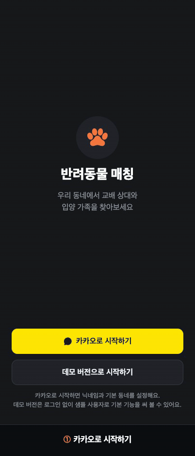
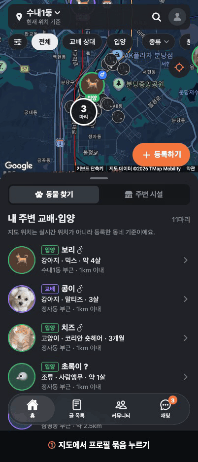
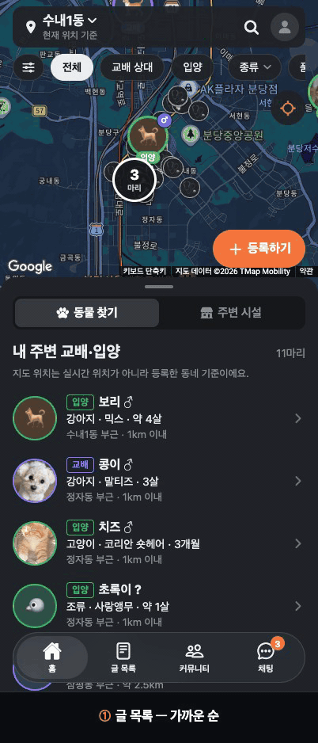
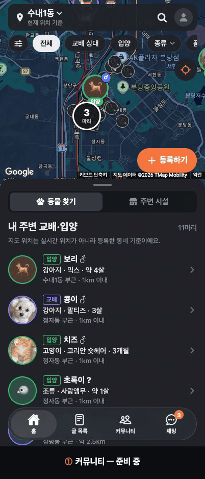

# matePet demo — 반려동물 교배·입양 매칭 앱 데모

내 주변의 **교배 상대**와 **입양 가족**을 지도에서 찾고, 동물병원·반려용품·반려동물 미용 같은 주변 시설도 함께 탐색하는 앱의 웹 데모입니다.
Expo(React Native) + Expo Router로 만들었고, 지금은 **웹**으로 제공합니다.

- 공개 데모: **https://matepet-demo.expo.app** (휴대폰으로 열거나, PC 브라우저를 휴대폰 화면 크기로 보세요)
- 첫 화면에서 **카카오로 시작하기**(가입 후 닉네임·기본 동네 설정) 또는 **데모 버전으로 시작하기**(로그인 없이 샘플 사용자)로 들어갑니다.

## 화면으로 보는 핵심 기능

> 아이폰 17 Pro 화면 크기(402×874)로 녹화했습니다. **수내1동에서 가입한 시연용 카카오 계정(가상)** 기준이며, 카카오 동의 화면은 생략했습니다. 누르는 곳에 터치 표시가 나옵니다.

<table>
  <tr>
    <td align="center" width="33%"><b>① 로그인 · 가입 · 동네 설정</b><br><br><sub>카카오로 시작 → 닉네임 자동 입력 → 실제 행정동으로 기본 동네 선택 → 지도에 동네 경계 표시</sub></td>
    <td align="center" width="33%"><b>② 지도 · 내 주변 글 · 거리 필터</b><br><br><sub>내 위치 주변 교배·입양 글을 가까운 순으로. 거리 필터로 범위를 좁히면 나와의 실제 거리가 보임</sub></td>
    <td align="center" width="33%"><b>③ 지도에서 글 상세</b><br><br><sub>지도의 프로필 묶음 → 같은 동네 글 선택 → 요약 시트 → 글 상세(사진·정보·나와의 거리)</sub></td>
  </tr>
  <tr>
    <td align="center"><b>④ 주변 시설 · 사진 · 후기</b><br><br><sub>반려동물 시설만 강조 표시 → 시설 선택 → 시트를 올려 사진·후기 확인</sub></td>
    <td align="center"><b>⑤ 글 목록 · 필터</b><br><br><sub>가까운 순 글 목록 → 입양 글만 보기 → 글 상세</sub></td>
    <td align="center"><b>⑥ 커뮤니티 · 채팅 (준비 중)</b><br><br><sub>커뮤니티는 준비 중, 채팅은 샘플 대화로 미리 보기</sub></td>
  </tr>
</table>

## 주요 기능

| 영역 | 내용 |
|---|---|
| 로그인·가입 | 첫 화면에서 카카오로 시작(Supabase Auth) 또는 '데모 버전으로 시작하기'(로그인 없이 샘플 사용자). 처음 로그인하면 프로필 설정(닉네임·기본 동네·필수 약관·만 14세 확인)을 마쳐야 앱으로 들어감 |
| 홈 (지도) | 등록 글을 원형 프로필 마커로 표시 (목적별 테두리·`교배`/`입양` 배지, 성별 배지). 가까운 마커는 숫자 묶음으로 합치고, 누르면 확대하거나 같은 동네 글 목록을 보여 줌. 고른 프로필 밑에 가려진 같은 자리 글은 `+N` 배지로 표시. 하단 시트에서 `동물 찾기 / 주변 시설` 전환(돌아오면 이전 지도 위치 복원) |
| 상단 바 | 지역 이름을 누르면 동네 선택, 그 오른쪽 빈 곳부터 돋보기까지는 반려동물 매장 검색(추천어: 반려용품·동물병원·애견미용·24시 동물병원 등) |
| 글 목록 | 검색 중심에서 가까운 순, 모집 중·상담 중 글만 표시 |
| 지역 설정 | 실제 행정동을 고름. 현재 위치에서 탐색(가장 우선) · 주변 동네 · 동네 이름 검색 · 지도에서 선택(고정 핀). 고른 동네의 경계를 지도에 표시. 홈 탐색 위치와 글 등록 동네는 따로 적용되고, 로그인 사용자의 기본 동네(프로필)가 홈 기본 지역과 새 글 등록 동네의 기본값 |
| 필터 | 목적·종류·품종·성별·거리(두 손잡이 슬라이더, 기본 0~20km, 최대 100km). 지도와 목록이 같은 필터를 공유하고, 결과가 없으면 거리 넓히기·조건 초기화를 제안 |
| 주변 시설 | 동물병원·반려용품·반려동물 미용 (Google Places, 반경 3km). 동물 찾기에서는 작은 아이콘, 주변 시설에서는 강조 아이콘. 시설 상세(주소·영업 여부·사진·후기)와 전화·길찾기, 사진은 처음 3장만 불러오고 '사진 더 보기' |
| 글 등록·수정 | 교배/입양 등록 폼, 필수 항목 검사, 임시저장. 작성자 본인 글만 수정·상태 변경(모집 중/상담 중/완료/일시 중지) 가능 |
| 프로필 | 카카오 프로필 사진·닉네임·기본 동네, 프로필 수정·로그아웃(데모 버전은 '데모 종료'). 내 등록 글·찜한 글·관심 시설 수 |
| 커뮤니티 | 준비 중 |
| 채팅 | 샘플 대화와 이 기기 안에서만의 메시지 전송, 읽지 않은 수 배지 (실시간 채팅은 준비 중) |

### 위치·개인정보 원칙

- 지도에 보이는 위치는 실시간 위치가 아니라 **등록한 동네의 중심점**입니다. 상세 주소는 저장만 하고 화면에 보여 주지 않습니다.
- 거리는 기준점(현재 위치, 모르면 기본 동네)과 동네 중심점 사이의 직선거리이며 `1km 이내`, `약 N km`로 반올림해 표시합니다.
- 프로필에는 닉네임·프로필 사진·기본 동네(행정동 코드와 대표 위치)만 저장하고, 정확한 좌표나 GPS 위치는 저장하지 않습니다.

## 실행 방법

필요: Expo SDK 58에 맞는 Node.js(검증 환경: 24.21.0), Google 지도 표시용·Places 서버용 키 각각 1개, 카카오 REST API 키(로컬 API — 좌표→행정구역), Supabase 프로젝트(로그인·프로필)

```bash
npm install
```

프로젝트 루트에 `.env` 파일을 만들고 키를 넣습니다. (`.env`는 저장소에 올라가지 않습니다. `.env.example`에는 변수 이름만 있습니다.)

```env
GOOGLE_MAPS_BROWSER_API_KEY=지도_표시용_별도_키
GOOGLE_REST_API_KEY=Places_서버용_키
KAKAO_REST_API_KEY=발급받은_키
SUPABASE_URL=https://프로젝트.supabase.co
SUPABASE_ANON_KEY=공개_anon_키
```

- 지도 표시용 키는 브라우저에 공개됩니다. Google Cloud에서 **Maps JavaScript API만 허용**하고 HTTP 리퍼러에 로컬·배포 도메인을 등록하세요. Places 서버용 키와 같은 키를 넣으면 `/api/maps-config`는 503을 반환하며 키를 공개하지 않습니다.
- Supabase는 공개(anon) 키만 넣습니다. `service_role`/secret 키를 넣으면 `/api/supabase-config`가 공개를 거부합니다.

```bash
npm run web
```

브라우저에서 `http://localhost:8081`을 엽니다. 휴대폰 화면 크기(예: 402×874)로 보는 것을 권장합니다.
첫 화면에서 '데모 버전으로 시작하기'를 누르면 로그인 없이 볼 수 있습니다. 위치 권한을 허용하면 현재 위치 기준으로, 허용하지 않으면 기본 동네(로그인 사용자는 프로필의 기본 동네, 데모 버전은 도촌동 — 성남시청이 있는 행정동) 기준으로 보여 줍니다.

```bash
npm test   # 서버 도우미 테스트 (지도 키 공개 방지, API 호출 제한)
```

### 카카오 로그인 설정 (Supabase)

1. Supabase 대시보드 SQL Editor에서 `supabase/migrations/0001_profiles.sql`을 실행해 프로필 테이블과 권한 규칙(RLS)을 만듭니다.
2. 카카오 개발자 콘솔: 카카오 로그인 활성화, REST API 키의 리다이렉트 URI에 `https://<프로젝트>.supabase.co/auth/v1/callback` 등록, 동의항목 닉네임·프로필 사진. Supabase는 카카오 이메일(`account_email`)을 항상 요청하므로 **비즈 앱 전환 후 이메일을 '선택 동의'**로 켜야 합니다.
3. Supabase Authentication → Providers → Kakao: REST API 키·Client Secret 입력, 'Allow users without an email' 켜기. URL Configuration의 Redirect URLs에 `<사이트 주소>/auth/callback`(로컬은 `http://localhost:8081/auth/callback`)을 추가합니다.

## 배포

웹 데모는 Expo 공식 호스팅(EAS Hosting)에 배포합니다.

```bash
npm run deploy
```

`.env`를 읽지 않고(`EXPO_NO_DOTENV=1`) 웹 빌드 후 `eas deploy --prod --environment production`을 실행합니다. 서버용 키는 EAS 환경변수(Production, **Sensitive**)에 두고, 로컬 `.env`는 올리지 않습니다. 자세한 내용은 [서버 배포 인계 문서](./서버-배포-클로드-인계.md)를 확인하세요.

## 기술 구성

- Expo SDK 58, React Native 0.88, Expo Router (`web.output: "server"` — API 라우트 사용)
- 로그인·DB: Supabase Auth(카카오) + Postgres `profiles` 테이블(읽기 공개·쓰기 본인만, RLS). 로그인 상태에 따라 들어갈 수 있는 화면을 `AuthGate`가 정합니다(로그인 전 → 로그인 화면, 프로필 없음 → 프로필 설정, 준비 완료·데모 → 앱).
- 지도: Google Maps JavaScript API (다크 모드), HTML 오버레이 마커. 지도 키는 `GOOGLE_MAPS_BROWSER_API_KEY`만 `/api/maps-config`에서 브라우저로 전달합니다.
- 장소: Google Places API (New). `GOOGLE_REST_API_KEY`는 서버 API 라우트(`src/app/api/*+api.ts`)에서만 사용하고 브라우저에는 노출하지 않습니다. 검색 결과는 저장하지 않습니다.
- 호출 제한(공개 배포용, `src/server/apiGuard.ts`): 장소 검색·상세·사진과 동네 확인 API는 다른 사이트에서 온 요청을 거부하고, 접속자별 1분 횟수와 API별 하루 전체 횟수를 제한합니다. 서버 메모리로 세므로 서버 인스턴스마다 따로 세는 최선 노력 제한이며, 확실한 상한은 Google Cloud 콘솔 할당량으로 겁니다.
- 상태: React Context (로그인·지도·글·찜·필터·채팅). 로그인 세션과 데모 버전 여부는 브라우저 저장소, 나머지는 메모리 저장

## 지역(행정동) 데이터

- 좌표가 속한 행정동: 카카오 로컬 `coord2regioncode`의 행정동(`region_type` H) 결과를 쓰고, 법정동(B)은 쓰지 않습니다. 키는 서버(`src/server/kakaoLocal.ts`)에서만 씁니다.
- 주변 동네 목록·동네 이름 검색: 아래 행정동 경계 데이터로 서버에서 직접 계산합니다. 전체 경계는 브라우저로 보내지 않습니다.
- 경계 강조: 홈 지도는 선택한 동네(또는 기본 동네)의 경계를, 지도에서 선택 화면은 핀 위치 조회가 끝난 동의 경계를 표시합니다. 필요한 한 동의 실제 경계만 받아 그리고(`/api/regions/boundary`), 검색 결과를 경계 안으로 제한하지는 않습니다.
- 지역 식별자는 행정안전부 10자리 행정기관코드입니다. 카카오 행정동 코드와 같은 체계임을 지원 지역 546개 행정동 전체의 대표 위치로 대조해 확인했습니다.
- 지원 지역(34개 시·군·구, 546개 행정동): 서울 전체(25개 구), 성남시(수정·중원·분당구), 과천시, 의왕시, 하남시, 광주시, 용인시 기흥·수지구. 그 밖의 지역은 '지원하지 않는 지역'으로 안내합니다.
- 기준일: **2026-10-01** (`HangJeongDong_ver20261001.geojson`, 좌표계 WGS84)

> 본 데이터는 통계청 통계지리정보서비스(SGIS, https://sgis.kostat.go.kr)에서 공공누리 제1유형으로 개방한 행정동 경계를 가공한 것이며(가공: vuski/admdongkor, https://github.com/vuski/admdongkor), CC BY 4.0으로 배포됩니다.

갱신 방법: [admdongkor](https://github.com/vuski/admdongkor)에서 최신 `HangJeongDong_verYYYYMMDD.geojson`을 내려받아 저장소 밖에 두고 아래를 실행합니다. `src/server/regions-data.json`(경계)과 `src/data/regionSamples.json`(샘플 글의 행정동)이 다시 만들어집니다. 지원 지역은 스크립트의 `SUPPORTED_SGG`(화면 안내용 `SUPPORTED_LABEL`도 함께)에서 바꿉니다.

```bash
node scripts/build-regions.mjs <내려받은 geojson 경로>
```

## 폴더 구조

```text
src/
  app/            화면과 API 라우트 (Expo Router)
    (tabs)/       하단 탭: 홈 지도, 글 목록, 커뮤니티, 채팅
    api/          서버 API: 장소(Google Places) 중계, 행정동(regions/*), 지도·로그인 공개 설정
    auth/         카카오 로그인 후 돌아오는 화면
  components/     지도·하단 시트·반려동물 UI, 입장 제어(AuthGate)
  data/           샘플 데이터와 거리·필터 계산
  lib/            Supabase 클라이언트
  state/          Context 상태 (로그인·지도·글·채팅·동네 선택 연결)
  server/         서버 전용 도우미 (Places·카카오·행정동 경계·호출 제한·공개 설정)
public/pets/      샘플 프로필 사진
supabase/         DB 테이블·권한(RLS) SQL
scripts/          행정동 경계 데이터 만들기
tests/            서버 도우미 테스트 (npm test)
docs/gifs/        README 기능 시연 GIF
```

## 데모의 한계

- 로그인과 프로필(닉네임·기본 동네)만 DB(Supabase)에 저장됩니다. **글·찜·채팅·임시저장은 아직 메모리에만 있어 새로고침하면 샘플 상태로 돌아가고**, 다른 사용자와 공유되지 않습니다.
- 샘플 글은 성남시와 주변 지역(분당·수서·문정·죽전) 기준입니다. 샘플 프로필 사진은 생성 이미지입니다.
- 채팅은 실제 전송·알림 없이 이 기기에서만 동작합니다. 커뮤니티 탭은 준비 중입니다.
- 약관은 제목만 있고 본문은 정식 출시 전에 법무 검토 후 붙입니다.
- 지도는 웹에서만 그립니다. iOS·Android 앱에서는 지도 연동 작업이 더 필요합니다.
- 반려용품(`pet_store`) 검색에는 구글 분류상 분양샵·수족관이 함께 나올 수 있습니다.
- 행정동 경계 근처(수십 m)에서는 카카오와 통계청 경계 자료가 서로 다른 동을 가리킬 수 있습니다. 이때는 카카오 판정을 따릅니다.
